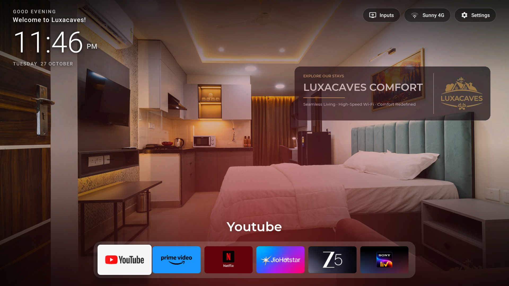
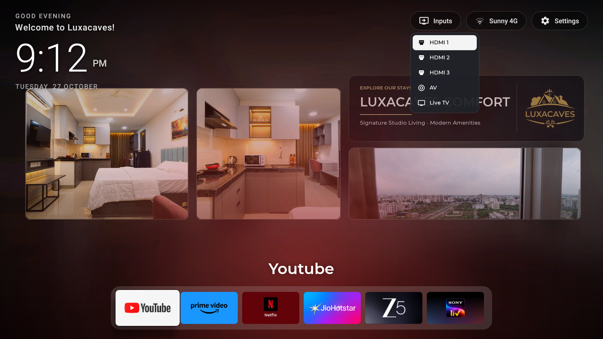
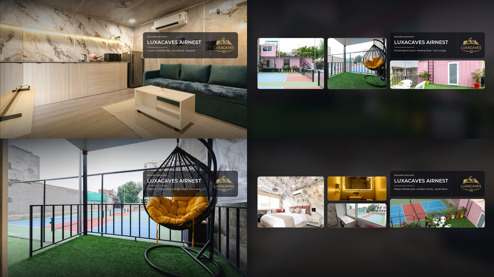

<div align="center">

# 🏨 Hospitality TV
### Turn Any Budget Smart TV into a Luxury Apple TV-Style Hospitality Experience for Your Airbnb or Boutique Stay

[](https://github.com/samkitpalecha/hospitality-tv/releases/latest)
[](https://github.com/samkitpalecha/hospitality-tv/releases/download/v1.0.0/hospitality-tv.apk)
[](https://opensource.org/licenses/MIT)
[](https://developer.android.com)
[-blue.svg)](launcher/build.py)
[](#)
[](#)

<br/>



<p align="center">
  <i>Captured live on an Android Smart TV running Hospitality TV at Luxacaves Boutique Stays.</i>
</p>

</div>

---

## ✨ Why Airbnb Hosts Need This

Most budget Smart TVs (TCL, Hisense, Xiaomi, Vu, CloudWalker, Fire TV) come out of the box with cluttered, ad-heavy interfaces:
- ❌ **Spam Ads & Clutter:** Unwanted apps, manufacturer recommendations, and slow OEM stores confuse guests.
- ❌ **Support Messages:** Guests constantly text: *"How do I switch to HDMI for my PlayStation?"* or *"Where is Netflix?"*
- ❌ **Cheap First Impression:** A generic budget TV UI ruins the luxury feel of a carefully designed space.
- ❌ **Commercial Solutions Cost \$15–\$30/mo/room:** Hotel TV software requires recurring fees and proprietary hardware.

### 🌟 What Hospitality TV Gives You:
- 👑 **Boutique Hotel Aesthetic:** Ambient, glassmorphic UI styled like Apple TV with your property’s branding, logo, and photography.
- 📸 **20-Second Listing Showcase:** Auto-rotates through native 1080p/4K hero shots and photo collages of your property highlights (pool, patio, suites, sunsets).
- 🎬 **Curated Guest App Dock:** Only the essentials (Netflix, Prime Video, YouTube, Disney+, Spotify). No clutter, no bloat.
- 🎮 **Direct 1-Click Inputs:** Dedicated popup switcher for **HDMI 1**, **HDMI 2**, **HDMI 3**, and **Live TV** with custom vector icons.
- ⚡ **Ultra-Fast & Lightweight:** Pure native Java, zero third-party dependencies, < 5 MB APK, uses only ~25 MB RAM. Boots instantly.
- 🔒 **Guest Privacy & Security:** 1-click debloater disables OEM background telemetry and shuts down ADB before guests check in.
- 💰 **100% Free & Open Source:** Zero subscriptions, zero external servers, runs entirely offline on the TV.

---

## 📺 Live TV Gallery

| Branded Ambient Home | Direct Hardware Input Switcher |
| :---: | :---: |
|  |  |
| *Boutique welcome, live clock/date, curated dock* | *Instant HDMI 1/2/3 and AV switching without OEM menus* |

<div align="center">
  
  <p><i>Auto-generated native 1080p hero shots and triptych/quad glassmorphic collages.</i></p>
</div>

---

## 🚀 5-Minute Quickstart

### Prerequisites
- A Smart TV running Android 5.0+ (or Fire TV) connected to your Wi-Fi.
- A laptop (Windows, macOS, or Linux) with Python 3.8+ installed.

### 1. Clone & Install Tools
```bash
git clone https://github.com/samkitpalecha/hospitality-tv.git
cd hospitality-tv
pip install -r tools/requirements.txt
```

### 2. Connect to Your TV
Enable **Developer Options** and **USB Debugging** on your TV:
> **Settings** → **About TV** → Click **Build Number** 7 times.  
> Go back to **Developer Options** → Enable **USB Debugging** / **Network Debugging**.

Find your TV's IP address (e.g. `192.168.1.50`) under **Settings → Network**, then test connection:
```bash
python tools/setup_tv.py 192.168.1.50 probe
```

### 3. Build & Install Your Branded Launcher
```bash
python tools/setup_tv.py 192.168.1.50 install
```
Your TV will instantly switch to the luxury Hospitality TV home screen!

### 4. Optional: Debloat Manufacturer Ads & Lock Down
Remove background manufacturer bloatware and speed up the TV:
```bash
python tools/setup_tv.py 192.168.1.50 debloat --profile cloudwalker_vw
```

When you are ready for guest check-in, lock down ADB wirelessly:
```bash
python tools/setup_tv.py 192.168.1.50 lockdown
```

---

## 🎨 Customizing for Your Property

You can fully customize the property name, welcome greeting, wallpaper gallery, and app dock in **under 2 minutes**:

### 1. Change Greeting & Property Name
Open [`launcher/res/values/config.xml`](launcher/res/values/config.xml):
```xml
<!-- Your guest greeting -->
<string name="welcome_message">Welcome to Sea Breeze Villa!</string>

<!-- Your property or brand name -->
<string name="property_name">Sea Breeze Luxury Stays</string>

<!-- Wallpaper auto-rotation interval (seconds) -->
<integer name="wallpaper_interval_seconds">20</integer>
```

### 2. Auto-Generate Wallpapers from Your Listing Photos
Drop 3 to 10 high-resolution photos of your stay into a folder (e.g., `my_photos/`) and your logo as `logo.png`:
```bash
python tools/generate_branding.py \
    --photos-dir ./my_photos \
    --logo ./my_photos/logo.png \
    --property "SEA BREEZE VILLA" \
    --subtitle "Private Heated Pool · Ocean Sunset · 4 Suites"
```
This automatically crafts 1080p full hero shots and glassmorphic triptych collages with dark gradient vignettes and drops them straight into `launcher/assets/wallpapers/`.

### 3. Customize the Curated App Dock
In [`launcher/res/values/config.xml`](launcher/res/values/config.xml), edit the `dock_apps` list:
```xml
<string-array name="dock_apps">
    <item>com.google.android.youtube.tv</item>
    <item>com.netflix.mediaclient</item>
    <item>com.amazon.amazonvideo.livingroom</item>
    <item>com.spotify.tv.android</item>
</string-array>
```
*Tip: If an app is listed but not installed on the TV, Hospitality TV automatically skips it.*

---

## 🛠️ Build Options

### Option A: Zero-Gradle Instant Build (Recommended)
Hospitality TV includes a lightning-fast build script that uses Android build tools directly without downloading heavy Gradle daemons:
```bash
python launcher/build.py
```
*Builds and signs `hospitality-tv.apk` in ~2 seconds.*

### Option B: Android Studio / Standard Gradle
Open the project root in **Android Studio** and click **Run** or build with:
```bash
./gradlew :launcher:assembleRelease
```

---

## 📱 Supported Hardware

Hospitality TV works on virtually any Android-based TV or streaming box:
- **Smart TVs:** TCL, Hisense, Xiaomi / Mi TV, Redmi, Vu, CloudWalker, Kodak, Blaupunkt, Thomson, Sony Bravia, Philips.
- **Streaming Devices:** Amazon Fire TV Stick, Chromecast with Google TV, Xiaomi TV Stick, NVIDIA Shield TV, Onn TV 4K.
- **Android Versions:** Android 5.0 (Lollipop, API 21) up to Android 14 (API 34).

---

## 🛡️ Debloat Profiles Included

| Profile | Target Brand | Description |
| :--- | :--- | :--- |
| `cloudwalker_vw.txt` | CloudWalker, VW, Shinco | Disables CW native home, OEM app store, and telemetry |
| `xiaomi_patchwall.txt` | Xiaomi Mi TV, Redmi TV | Disables PatchWall ads, recommendations, and analytics |
| `firetv.txt` | Amazon Fire TV / Stick | Disables home screen auto-playing video ads and shopping carousels |
| `hisense_vidaa.txt` | Hisense Android TVs | Removes OEM video carousels and partner promotions |
| `tcl.txt` | TCL Android TVs | Disables TCL Channel, T-Cast, and background analytics |

---

## 🤝 Contributing

Contributions are warmly welcomed! If you created a debloat profile for your TV brand or have improvements for guest hospitality features, feel free to submit a Pull Request.

1. Fork the Project
2. Create your Feature Branch (`git checkout -b feature/AmazingFeature`)
3. Commit your Changes (`git commit -m 'Add AmazingFeature'`)
4. Push to the Branch (`git push origin feature/AmazingFeature`)
5. Open a Pull Request

---

## 📄 License

Distributed under the **MIT License**. See [`LICENSE`](LICENSE) for details.

<div align="center">
  <sub>Built with ❤️ for boutique hosts, vacation rentals, and Airbnb superhosts worldwide.</sub>
</div>
